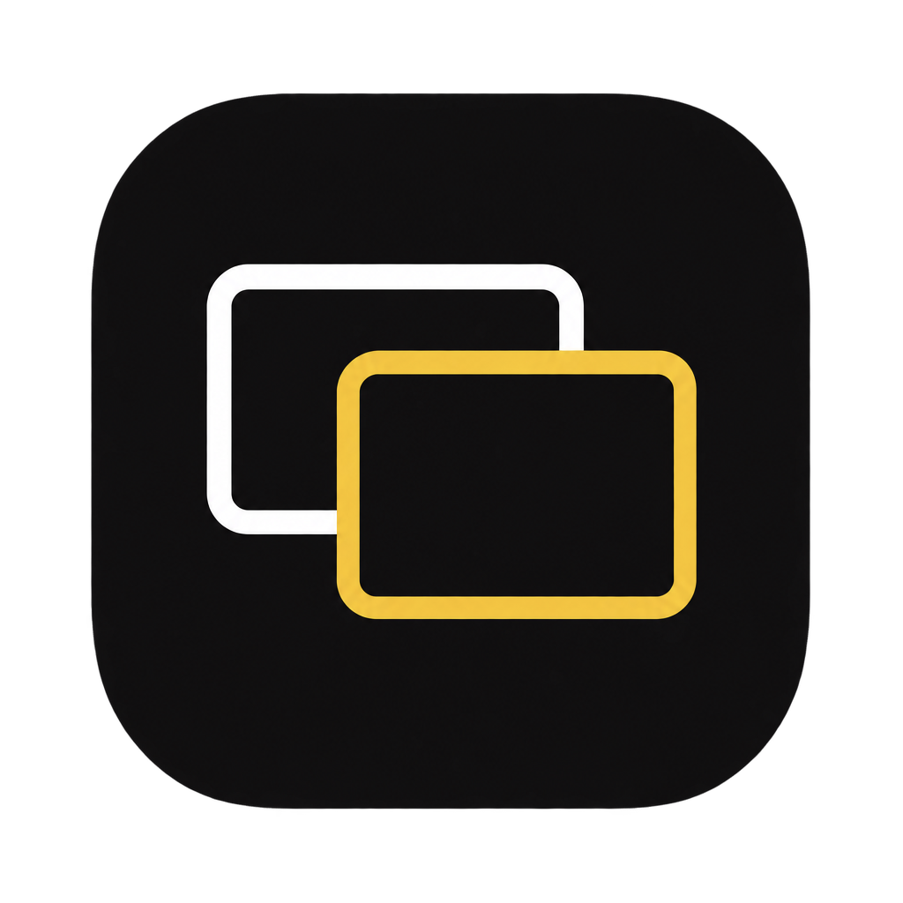

# Switchboard



Switchboard is a small, open source macOS menu bar app. It changes the input of each monitor that is connected to your Mac, so one monitor can show your Mac or another device without a cable change.

Status: the Must version is implemented. It is not tested on hardware yet. Screenshots come after the hardware test.

## Install

### Homebrew

```sh
brew install --cask jpc4729/tap/switchboard
```

The cask installs the app and links the `switchboard` command.

### GitHub Releases

1. Download `Switchboard-X.Y.Z.zip` from [Releases](https://github.com/jpc4729/switchboard/releases).
2. Unzip it.
3. Move `Switchboard.app` to Applications.

### Build from source

```sh
./scripts/bundle.sh
open build/Switchboard.app
```

For a debug build, use `swift build`. To build the rule tests, use `swift build --build-tests`. To run them, use `swift test`.

The maintainers run commands through a `quiet` wrapper. It is optional, and the repo does not need it.

## First launch

The app is not notarized, because notarization needs a paid Apple Developer ID. macOS blocks it at the first launch. To open it:

1. Open Switchboard once. macOS stops it.
2. Go to System Settings > Privacy & Security.
3. Click Open Anyway, and type your password.

Or remove the quarantine flag in Terminal:

```sh
xattr -dr com.apple.quarantine /Applications/Switchboard.app
```

On macOS 15 and later, Control-click and Open no longer works for this.

A build from source is not quarantined, so it opens without these steps.

## What it does

- A menu bar icon only. No Dock icon.
- Any number of screens and devices. You give each one a name.
- For each screen, the menu shows the Mac, each device and Off. A checkmark shows the current choice.
- When a screen shows a device, the Mac stops using that screen, so your windows move to the screens that you can see.
- Back to Computer turns all screens on again and switches each one back to the Mac. The shortcut is ⌃⌥⌘B. Quit, logout and restart also do this. If another app uses ⌃⌥⌘B, Switchboard tells you at launch, and you use the menu.
- The last screen always stays on. You select what the Mac does then: sleep or keep running. Keep Running stops the Mac from going to sleep while no screen shows it. If the lid is closed, Switchboard asks before it does this.
- The menu bar shows the device names when a screen is away, and a warning icon when an action failed. Errors are in plain words. When a screen does not switch, the message tells you what to try.
- When you open the menu, Switchboard asks each screen which input it shows, so the checkmarks follow the screen's own button too. A change shows the next time you open the menu.
- Setup finds each external screen and reads which input the Mac is on. Switchboard cannot see which device is on an input: press Test to see an input for 5 seconds, then type the name of the device. Setup opens at first launch, from Set Up Screens… in the menu, and from Set Up This Screen… on a new screen.
- If a monitor uses other input codes, Setup adds the code that it reads, and you can add a code (1 to 255) by hand.
- Open Window (⌘O in the menu, or open the app again from Finder) shows the same controls in a small window: a picker for each screen, Back to Computer and Set Up Screens….
- Open at Login in the menu starts Switchboard when you log in.
- Other apps, such as Shortcuts, Stream Deck or Terminal, can open these links:
  - `switchboard://back` does Back to Computer.
  - `switchboard://switch?screen=Odyssey&to=PS5` switches one screen. `to` is `mac`, `off` or a device name. Names are not case-sensitive.

## Requirements

- macOS 13 or later.
- Apple Silicon. Intel Macs are not supported for input switching.
- Monitors with DDC/CI on. Most monitors have this setting in their own menu.

## Command line

The `switchboard` command sends the same links to the running app.

```sh
switchboard back
switchboard switch "Odyssey G7" PS5
switchboard switch Odyssey mac
switchboard switch Odyssey off
switchboard --print switch "Odyssey G7" PS5
switchboard --help
```

- `back` does Back to Computer.
- `switch <screen> <to>` switches one screen. `to` is `mac`, `off` or a device name. Names are not case-sensitive. Put names with spaces in quotes.
- `--print` prints the link and does not open it.
- A usage error exits with code 64.

The Homebrew cask links the command for you. For a build from source, link it to a folder on your PATH. This example uses `/usr/local/bin`:

```sh
ln -s "$PWD/build/Switchboard.app/Contents/Resources/switchboard" /usr/local/bin/switchboard
```

## Why not the App Store

Switchboard uses private APIs (`CGSConfigureDisplayEnabled` and `IOAVService`). The App Store does not allow them. Switchboard is free and open source, and it ships through GitHub and Homebrew.

## Privacy

Switchboard works offline. It collects nothing and sends nothing.

## Design notes

- Switchboard changes the monitor input with DDC/CI (VCP code 0x60) through the private Apple Silicon `IOAVService` calls. The code follows [MonitorControl](https://github.com/MonitorControl/MonitorControl) and [m1ddc](https://github.com/waydabber/m1ddc).
- macOS has no public API to disconnect a display. Switchboard uses the private CoreGraphics call `CGSConfigureDisplayEnabled`, inside a public `CGBeginDisplayConfiguration` and `CGCompleteDisplayConfiguration` transaction. [LightsOut](https://github.com/AlonX2/LightsOut) and [ScreenOff](https://github.com/zy0816/ScreenOff) use the same call.
- A switch sends DDC first. If DDC fails, nothing changes.
- Some monitors do not accept DDC on an input that is not shown. Then Back to Computer turns the screen on again in macOS, and you select the Mac with the screen's own button. The order does not matter.
- The change uses the `.forSession` scope, so a logout or a restart turns all displays on again.
- A disabled display goes out of the system display lists. Switchboard saves the IDs and UUIDs of the displays that it disabled, so that it can turn them on again with their settings, also after a crash.
- macOS can report an error for a display change that worked. Switchboard reads the real display state and reports an error only when the state did not change.
- Switchboard never disables the last real screen. It keeps that screen on and, if you selected Sleep, puts the Mac to sleep.
- If no real screen is left on, for example after you disconnect a monitor, Switchboard does Back to Computer. It does not do this when you sent the last screen to a device yourself.
- Display and DDC calls can block for some seconds. Switchboard runs them on one background queue.
- After the Mac wakes, Switchboard checks the screens again, the same as after a screen change.
- Keep Running holds an IOKit power assertion that prevents idle sleep. Sleep uses `pmset sleepnow`, because macOS has no public call to sleep now.
- The lid state comes from the `AppleClamshellState` value in the IORegistry. Apple does not document it. A Mac without a lid has no value, and Switchboard takes the lid as open.
- Many Samsung monitors accept DDC only over HDMI, and picture features such as Input Signal Plus or Dynamic Brightness can block it. Setup does not try all input codes for you, because each try switches the monitor and makes the screen go black.
- The links use a URL scheme. App Intents would need an Xcode build, and Switchboard builds with SwiftPM.

## Contributing and security

- [CONTRIBUTING.md](CONTRIBUTING.md) tells you how to report a problem and send a change.
- [SECURITY.md](SECURITY.md) tells you how to report a security problem.
- [CHANGELOG.md](CHANGELOG.md) lists the changes.
- [packaging/homebrew](packaging/homebrew) has the cask template and the tap setup notes.

## License

[MIT](LICENSE)
